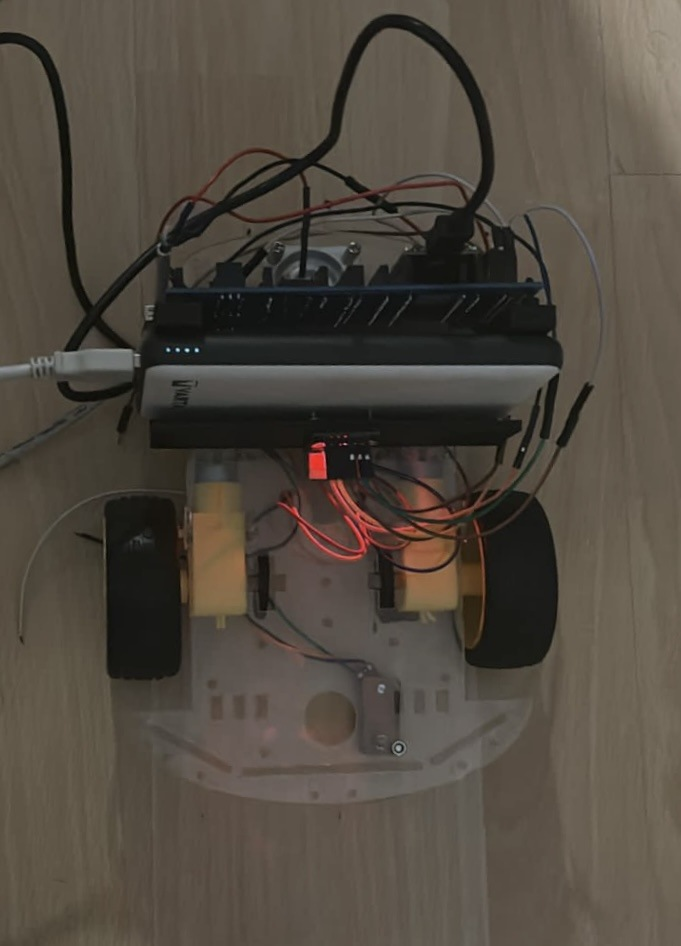
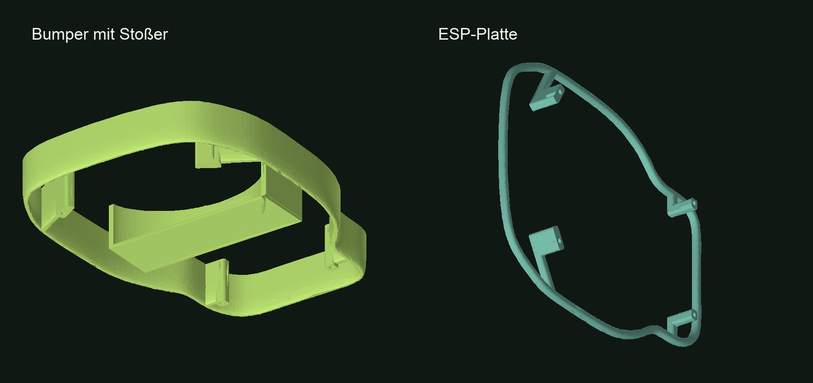

# RoboCar – Software, Sensorik und 3D-Druck

**Enes Türksever · Erstsemesterprojekt Informatik · Hochschule Niederrhein · 2023/24**

Ein per Smartphone gesteuertes Roboterauto für Autofußball: Zwei Motoren bewegen das Fahrzeug, zwei Reflexionssensoren erkennen die schwarze Spielfeldgrenze. Dazu entstanden eigene 3D-gedruckte Bauteile für den Fahrzeugaufbau und den Kontakt mit dem Ball.

  

## Mein Beitrag

Mein Schwerpunkt im Teamprojekt lag auf der **Fahrzeugsoftware**: Motoren ansteuern, Sensorwerte auslesen und die Bedienung per Smartphone mit RemoteXY integrieren. Dazu gehörten das Testen einzelner Komponenten und die Fehlersuche beim Zusammenspiel von App und Fahrzeug. Außerdem habe ich an der Gestaltung der **3D-Modelle** mitgewirkt.

Dieses Repository zeigt meinen Beitrag zum gemeinsamen Projekt. Es beansprucht keine alleinige Urheberschaft an der gesamten Teamleistung. [Metin Arslancan beschreibt seine Arbeiten an Konstruktion und Verkabelung in seinem Repository](https://github.com/Metin-Arslancan/esp32-robocar).

## Was die Software macht

| Bereich | Umsetzung im dokumentierten Softwarestand |
| --- | --- |
| Fernbedienung | Smartphone-App über Bluetooth Low Energy mit RemoteXY |
| Antrieb | Getrennte Geschwindigkeits- und Richtungsansteuerung beider Motoren |
| Linienerkennung | Zwei analoge Reflexionssensoren; Reaktion, sobald einer den Schwellwert erreicht |
| Reaktion an der Grenze | Kurz zurückfahren, anschließend anhalten und warten |
| Fehlersuche | Sensorwerte über die serielle Schnittstelle ausgeben |

**Technik:** ESP32 · Arduino IDE · C++ · RemoteXY/BLE · DC-Motoren · Reflexionssensoren · 3D-Druck

Der überlieferte Code verwendet den Schwellwert `3000`, fährt bei Erkennung etwa `700 ms` zurück und hält danach `2000 ms` an. Diese Werte gehören zum damaligen Versuchsaufbau und sind keine allgemeingültige Kalibrierung.

### Vom Einzeltest zum Zusammenspiel

Zunächst wurden Motoren und Sensoren mit kleinen Testprogrammen geprüft. Danach verbanden wir die Motoransteuerung mit den Reglern der Smartphone-App. Die Linienerkennung greift in diese Bedienung ein: Erkennt mindestens ein Sensor die Grenze, führt das Fahrzeug die Rückfahr- und Stopproutine aus. So wurden aus einzelnen Hardwaretests eine gemeinsame Fahrzeuglogik.

## 3D-Modelle

| Bauteil | Dateien |
| --- | --- |
| Bumper mit Stoßer | [3MF](models/bumper-mit-stosser.3mf) · [STL aus diesem 3MF](models/bumper-mit-stosser.stl) · [separat überlieferte STL-Variante](models/bumper-mit-stosser-original.stl) |
| ESP-Platte | [3MF](models/esp-platte.3mf) · [STL aus diesem 3MF](models/esp-platte.stl) |

Die 3MF-Dateien enthalten die ursprünglichen Netze in Millimetern, ohne persönliche Dateipfade oder gerätespezifische Druckprofile. Die ergänzenden STL-Dateien wurden daraus exportiert. Druckausrichtung, Material und Einstellungen müssen vor dem Drucken passend gewählt werden. [Details zu den Modellständen](docs/modelle.md).

## Code und Einordnung

Der [dokumentierte Softwarestand](src/robocar-dokumentierter-stand.ino.txt) wurde aus dem Quellcode-Anhang der damaligen Dokumentation übernommen. Er zeigt Motorlogik, Sensorauswertung und RemoteXY-Anbindung.

**Die vollständige lauffähige Firmware ist mit diesen Unterlagen nicht überliefert:** Die RemoteXY-Konfigurationsbytes sind im Anhang durch einen Platzhalter ersetzt. Deshalb liegt die Datei ausdrücklich als `.ino.txt` vor. Fehlende Teile wurden nicht nachträglich als damaliger Originalcode ergänzt.

[Softwareaufbau und technische Grenzen lesen →](docs/software.md)

## Was ich daraus mitgenommen habe

- Software schrittweise mit realer Hardware prüfen, statt erst das komplette Fahrzeug zu testen.
- Sensorwerte am tatsächlichen Untergrund messen und Schwellwerte daran ausrichten.
- Mechanik, Verkabelung und Programmierung gemeinsam betrachten: Eine gute Anordnung erleichtert Fehlersuche und Änderungen.
- Bei einer Weiterentwicklung würde ich die blockierenden Wartezeiten durch eine zeitgesteuerte Zustandslogik ersetzen und einen definierten Stopp bei Verbindungsabbruch ergänzen.

Die ursprünglichen Abgabedokumente bleiben außerhalb dieses Repositories. Die Beschreibung wurde für das Portfolio neu formuliert; persönliche Kontaktdaten, weitere Namen und Metadaten wurden nicht übernommen.
